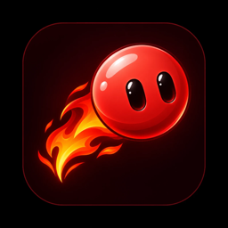

# Bouncer Ignis privacy policy

---

**Short version:** Bouncer Ignis runs on your computer and keeps your data there. It has no analytics, no telemetry, no crash reporting and no accounts. The author of Ignis receives nothing about you or how you use it.

## What stays on your machine

Your models, your chats in Chat, your Rebound bots, their memories, routines and chats, the folders and files you open in Code, Code's checkpoints and sessions, and your settings. A chat with a local model is answered by the model on your computer; your messages are not sent to a server for a reply.

The local API listens on this computer only unless you change that, and it takes requests from web pages only for origins you allow. See [Local API](docs/local-api.md).

## What connects to the internet, and when

Ignis only goes online for these tasks, and only when you use the feature that needs them:

| Feature | Who it contacts | What is sent |
| --- | --- | --- |
| Marketplace search and model pages | Hugging Face | Requests for model listings, files and model cards |
| Downloading a model (the Marketplace, `ignis pull`, or an Ollama `pull` request to the local API) | Hugging Face | A request for the model file you chose |
| Gated models | Hugging Face | Your Hugging Face token, only if you set `HF_TOKEN` before starting Ignis, and only to Hugging Face |
| Searching for or installing a package (`ignis search`, `install`, `update`) | Bouncer's package index at bouncer-ai.pages.dev, then Hugging Face | Requests for the index and the package file, then for the package's model |

These services receive the request the same way they would from a browser, so their own privacy policies apply to what they log. Ignis adds no identifiers of its own.

Ignis has no update check and no web search. It never contacts a cloud model provider.

## Your Hugging Face token

Ignis does not store a Hugging Face token. If you set `HF_TOKEN` in the environment before you start Ignis, it is sent only to Hugging Face.

## Code can run commands

Code works inside the folder you choose, and it runs commands on your computer when the mode allows it. Commands that use the network, install packages or read secret files always ask first, even in autopilot. A command you approve can still contact the internet. Choose plan or manual mode for folders with sensitive files.

## Deleting your data

Uninstalling Ignis and deleting its data folder removes what Ignis stored. The folder is `~/Library/Application Support/Bouncer Ignis`. The model library is Bouncer's, in `~/Library/Application Support/Bouncer/models`, and stays until you delete the models. See [Install](docs/install.md#uninstall).

## Changes

If this policy changes, the new version will be published in this repository and noted in the [changelog](CHANGELOG.md).

## Contact

Questions go to [GitHub issues](https://github.com/shankar-sachin/get-ignis/issues). The full technical details are in [docs/privacy.md](docs/privacy.md).
