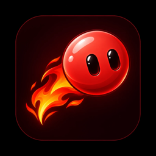
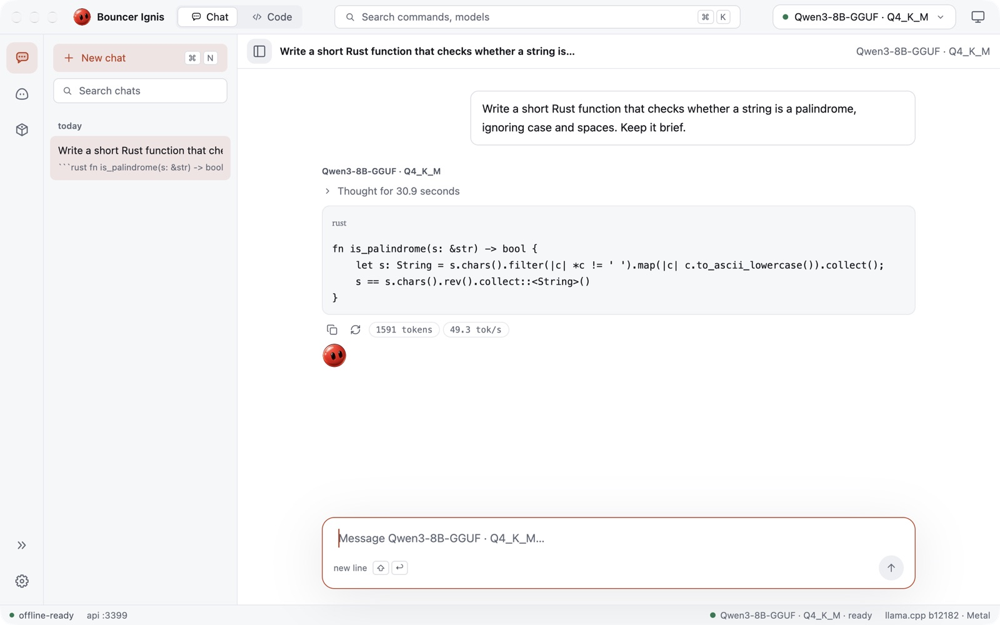
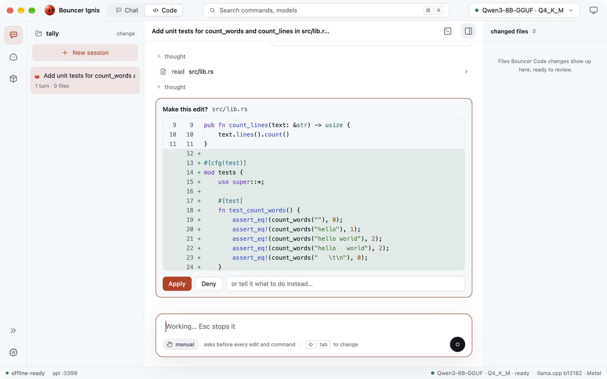
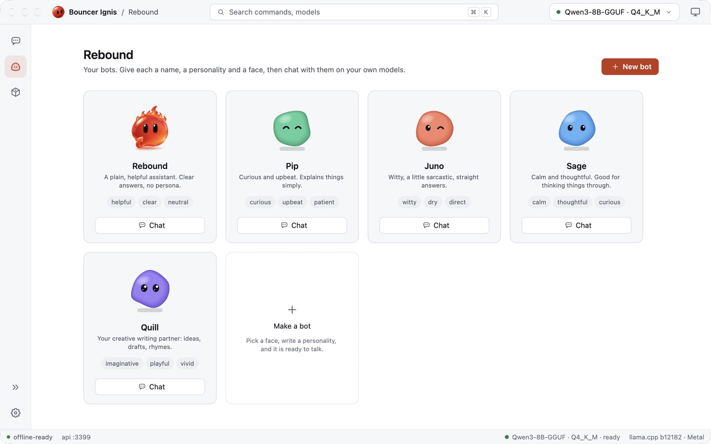

<p align="center">
  
</p>

<h1 align="center">Bouncer Ignis</h1>

<p align="center">
  <strong>The lean edition of Bouncer. Open models on your own Mac, with a fraction of the memory.</strong><br />
  Local-first. No account. No telemetry.
</p>

<p align="center">
  <a href="https://github.com/shankar-sachin/get-ignis/releases/latest"></a>
  <a href="https://github.com/shankar-sachin/get-ignis/releases"></a>
  
</p>

<p align="center">
  <a href="https://bouncer-ai.pages.dev/ignis"><strong>Website</strong></a> ·
  <a href="https://bouncer-ai.pages.dev/ignis/docs"><strong>Docs</strong></a> ·
  <a href="https://github.com/shankar-sachin/get-ignis/releases/latest"><strong>Download</strong></a> ·
  <a href="CHANGELOG.md"><strong>Changelog</strong></a> ·
  <a href="https://github.com/shankar-sachin/get-ignis/issues/new/choose"><strong>Report a bug</strong></a>
</p>

<p align="center">
  <picture><source media="(prefers-color-scheme: dark)" srcset="site/assets/screens/hero-obsidian.jpg"><source media="(prefers-color-scheme: light)" srcset="site/assets/screens/hero-light.jpg"></picture>
</p>

Bouncer Ignis is a local-first AI app for macOS on Apple silicon. It is the lean edition of [Bouncer](https://bouncer-ai.pages.dev): the same model library and the same look, written in Rust, so it uses a fraction of the memory of the Electron app. It finds open models on Hugging Face, checks they fit your Mac, and runs them with [llama.cpp](https://github.com/ggml-org/llama.cpp) (GGUF), built into the app. Your chats, files and models stay on your computer.

## Install

```sh
curl -fsSL https://bouncer-ai.pages.dev/ignis/install.sh | sh
```

The installer fetches the [latest release](https://github.com/shankar-sachin/get-ignis/releases/latest) and checks it against its `SHA256SUMS`. Add `--dry-run` (`| sh -s -- --dry-run`) to see what would happen first, `--version v0.2.0` to pick a version, or `--cli-only` to install only the `ignis` and `bi` commands. It runs on macOS only for now.

Prefer to download it yourself? Every file is on the [releases page](https://github.com/shankar-sachin/get-ignis/releases):

| File | What it is |
| --- | --- |
| `Bouncer-Ignis-<version>-arm64.dmg` | The app, as a disk image |
| `Bouncer-Ignis-<version>-arm64-mac.zip` | The app, as a zip |
| `ignis-cli-<version>-macos-arm64.tar.gz` | Just the `ignis` and `bi` commands |
| `SHA256SUMS` | Checksums for the files above |

Builds are not signed or notarized yet. If macOS blocks the app, right-click it and choose Open, or run `xattr -dr com.apple.quarantine "/Applications/Bouncer Ignis.app"`. More in the [install guide](docs/install.md) and the [system requirements](docs/system-requirements.md).

## What's inside

| | |
| --- | --- |
| **[Chat](docs/chat.md)** | Talk with a model you have loaded. Chats are saved, and you can rename or delete them. |
| **[Code](docs/code.md)** | Point a model at a folder. It reads, edits and runs commands, and you review each change as a diff. Four modes, checkpoints to rewind, a terminal panel, `@` file mentions and compaction. |
| **[Rebound](docs/rebound.md)** | Your own bots, each with a name, a personality, a face and a memory. Routines run a bot on a schedule. |
| **[Marketplace](docs/models.md)** | Search GGUF models on Hugging Face, check how each file fits your Mac, and download them. Your [library](docs/models.md#the-library) is shared with Bouncer. |
| **[Settings](docs/settings.md)** | Theme, accent, the service, how many models load at once, and your hardware. |
| **[`ignis`](docs/cli.md)** | The background service and model manager. It runs llama.cpp and serves the [local API](docs/local-api.md). |
| **[`bi`](docs/cli.md#bi)** | Chat in the terminal, full screen or one reply at a time. |

<p align="center">
  <picture><source media="(prefers-color-scheme: dark)" srcset="site/assets/screens/code-obsidian.jpg"></picture>
  <picture><source media="(prefers-color-scheme: dark)" srcset="site/assets/screens/rebound-obsidian.jpg"></picture>
</p>

## Ignis and Bouncer

Ignis is not a replacement for Bouncer. It does less, on purpose.

| | Bouncer Ignis | Bouncer |
| --- | --- | --- |
| Built with | Rust | Electron |
| Memory use | A fraction | Larger |
| Systems | macOS, Apple silicon | macOS, Windows, Linux |
| Chat, Code, Rebound, Marketplace | Yes | Yes |
| Model library and packages | Shared with Bouncer | Shared with Ignis |
| Local API (OpenAI, Anthropic and Ollama shapes) | Yes, on port 3333 | Yes, on port 3133 |
| IDE, Studio, Lab, Workflows | No | Yes |
| MLX models | No | Yes |
| Cloud providers | No | Optional |
| Voice input | No | Yes |
| Plugins | No | Yes |
| Accounts and sync | No | Optional |
| Updates | By hand for now | Built in |

You can install both. See [Ignis with Bouncer](docs/with-bouncer.md).

## Use with Claude Code

Ignis answers in Anthropic's Messages shape, so Claude Code can use a model on your Mac:

```sh
ANTHROPIC_BASE_URL=http://localhost:3333 ANTHROPIC_AUTH_TOKEN=ignis claude --model <model>
```

Replace `<model>` with a name from `ignis list`. The [Claude Code guide](docs/claude-code.md) has the details.

## Documentation

The full guide is at **[bouncer-ai.pages.dev/ignis/docs](https://bouncer-ai.pages.dev/ignis/docs)**. Its source is in [`docs/`](docs/README.md), mirrored to the [wiki](https://github.com/shankar-sachin/get-ignis/wiki).

- **Start:** [Getting started](docs/getting-started.md) · [Install](docs/install.md) · [Updates](docs/updates.md) · [System requirements](docs/system-requirements.md)
- **Use:** [Chat](docs/chat.md) · [Code](docs/code.md) · [Rebound](docs/rebound.md) · [Models](docs/models.md) · [Terminal commands](docs/cli.md)
- **Connect:** [Local API](docs/local-api.md) · [Claude Code](docs/claude-code.md) · [Ignis with Bouncer](docs/with-bouncer.md)
- **Reference:** [Settings](docs/settings.md) · [Keyboard shortcuts](docs/keyboard-shortcuts.md) · [Privacy](docs/privacy.md)
- **Help:** [Troubleshooting](docs/troubleshooting.md) · [FAQ](docs/faq.md)

## Claude Code plugin

This repository is also a Claude Code plugin marketplace. The `ignis` plugin adds `/ignis:status`, `/ignis:models`, `/ignis:ask` (a second opinion from your local model) and `/ignis:serve-claude`, plus a skill for handing small private tasks to the local model.

```
/plugin marketplace add shankar-sachin/get-ignis
/plugin install ignis@get-ignis
```

More in [`plugins/`](plugins/README.md).

## Privacy

Ignis is local-first. A chat with a local model is processed on your machine, and Ignis has no analytics, no telemetry and no accounts. It goes online only for:

- **Hugging Face:** model listings, model cards and the files you choose to download.
- **Bouncer's package index:** only when you search for or install a package with `ignis`.

The full list is in the [privacy policy](PRIVACY.md) and [docs/privacy.md](docs/privacy.md).

## Reporting bugs

[Open an issue](https://github.com/shankar-sachin/get-ignis/issues/new/choose) and pick a template. Include your Ignis version (**Settings, about**, or `ignis --version`), your Mac, and the service log lines around the error (`ignis logs`), with any private text removed. For security problems, see [SECURITY.md](SECURITY.md) and don't open a public issue.

## About this repository

Ignis's source code is private. This repository holds everything public around it: the [docs](docs/README.md), the [website](site), [examples](examples/README.md), the [install script](scripts) and the issue templates in [`.github/`](.github).

## License

Ignis is free to download and use, and its source code is private. See the [license](LICENSE.md) for the terms.

<sub>© Sachin Shankar. All rights reserved.</sub>
