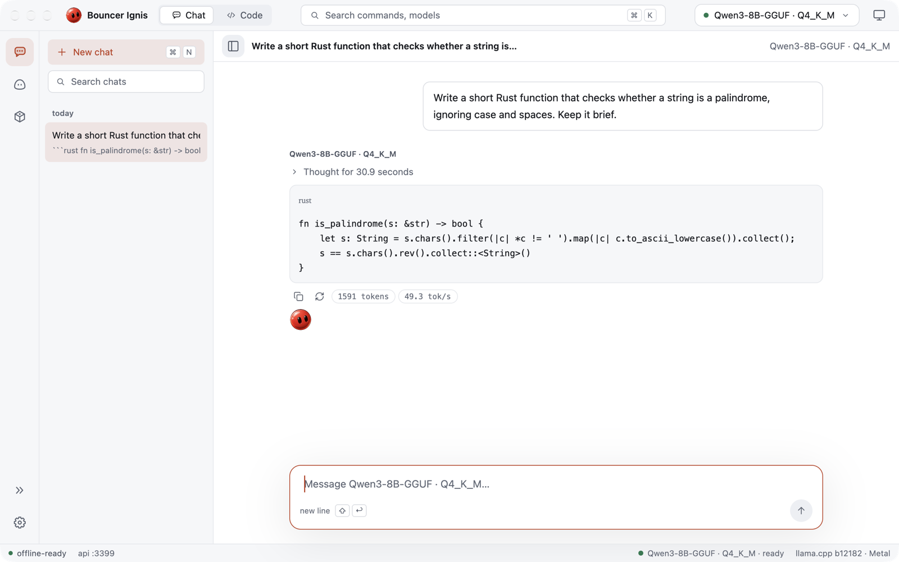

# Chat

Chat is where you talk with a model that runs on your Mac. Open it with <kbd>⌘</kbd> <kbd>1</kbd> or the **Chat** button in the title bar.

<picture><source media="(prefers-color-scheme: dark)" srcset="images/hero-obsidian.png"><source media="(prefers-color-scheme: light)" srcset="images/hero-light.png"></picture>

## Pick a model

The model pill in the title bar shows the loaded model and its state. Click it to see **models on this machine**, choose one, or open the Marketplace with **Browse the Marketplace**. Choosing a model loads it. The status bar shows the model, its state (loading, ready or failed) and the `llama.cpp` version.

Until a model is chosen, the composer says *Pick a model in the title bar to start…*. While it loads, it says *Loading* and the model name.

## Send a message

Type in the composer and press <kbd>Enter</kbd>. Press <kbd>Shift</kbd> <kbd>Enter</kbd> for a new line. On an empty chat, four starter prompts fill the composer for you: **Explain something simply**, **Help me with some code**, **Draft or tighten some writing** and **Summarize a document**. Nothing is sent until you press <kbd>Enter</kbd>.

While a reply streams, the bouncing ball shows that the model is working, and the status bar shows tokens per second. Press <kbd>Esc</kbd> to stop the reply. A stopped reply stays in the chat.

If a model thinks before it answers, the reply starts with a **Thinking** line that becomes *Thought for 3.2 seconds* when it is done.

Under each reply:

- **Copy** copies it.
- **Regenerate** asks the model again.
- The speed and the number of tokens show next to them.

## Saved chats

Every chat is saved on this Mac as soon as you send a message, in `~/Library/Application Support/Bouncer Ignis/chats`. Show or hide the chat list with the **Sidebar** button in the title bar.

- **New chat**: <kbd>⌘</kbd> <kbd>N</kbd>, or the **New chat** button.
- **Search chats**: type in the search box above the list. *No chats match.* means nothing matched.
- **Rename**: hover a chat and choose **Rename chat**. Press <kbd>Enter</kbd> to save, <kbd>Esc</kbd> to cancel.
- **Delete**: hover a chat and choose **Delete chat**. Ignis asks *Delete this chat?*. Choose **Delete**, or **Keep it**.

A new chat is titled from its first message.

## Chat in the terminal

`bi` is the same kind of chat in the terminal. See [Terminal commands](cli.md#bi).

## Related

- [Models](models.md)
- [Rebound](rebound.md): chats with bots that have a personality and a memory.
- [Keyboard shortcuts](keyboard-shortcuts.md)
- [Local API](local-api.md)
