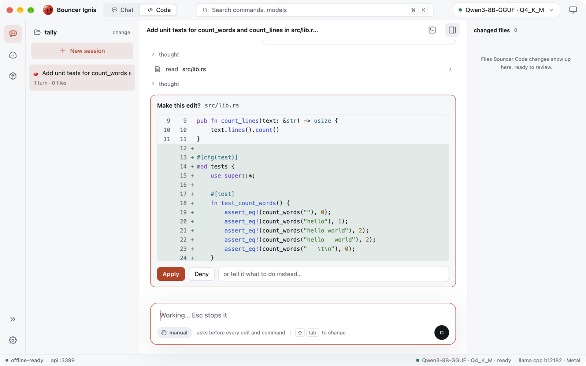

# Code

Code is an agent that works on a folder. You describe a change, a bug or a feature. The model reads files, edits them and runs commands, and you review what it does. Open it with <kbd>⌘</kbd> <kbd>2</kbd> or the **Code** button in the title bar.

<picture><source media="(prefers-color-scheme: dark)" srcset="images/code-obsidian.png"><source media="(prefers-color-scheme: light)" srcset="images/code-light.png"></picture>

Code uses a model you load in the title bar, the same way Chat does. Models of 14 billion parameters and up do better at coding work.

## Choose a folder

On the start screen, click **Choose a folder**. Code works inside that folder, and only there. Recent folders are listed below it. Each folder has its own sessions.

## Modes

The mode sets what Code may do without asking. Press <kbd>Shift</kbd> <kbd>Tab</kbd> to cycle through them, or pick one under the composer.

| Mode | What it does |
| --- | --- |
| **plan** | Read-only. It looks at your code and proposes a plan. Edits and commands are refused. |
| **manual** | Asks before every edit and command. |
| **accept edits** | Edits apply. Commands ask. This is the default. |
| **autopilot** | Runs everything in this folder without asking. |

Reading files, listing, searching and the task list never ask. Some commands always ask, even in autopilot: those that install packages, publish, delete in bulk, use the network or read secret files. Some commands never run in any mode, such as `sudo` and `shutdown`. Choose **plan** or **manual** for folders with sensitive files.

## What Code can do

Code has eight tools: list a folder, find files by name, search file contents, read a file, edit a file, write a file, run a command, and keep a task list. When it works, each step shows as a line in the transcript, such as *read src/lib.rs* or *searched for*, with a **+added** and **−removed** count for edits.

Commands run in your folder. A command is stopped after two minutes unless Code asks for longer, up to ten. If the same step fails three times in a row, Code stops and says so. After 50 steps in one turn, it stops and says *Stopped after 50 steps. Send a message to go on.*

## Approve a change

When a step needs your approval, a card asks *Run this command?*, *Create this file?* or *Make this edit?*, with the diff or the command. Choose **Run** or **Apply** to allow it, or **Deny**. To tell Code what to do instead, type in the feedback box before you choose **Deny**.

## Review changes

Click **Changed files** in the title bar to open the panel on the right. It lists the files Code changed in this session, each with its diff. *Files Code changes show up here, ready to review.* shows until there is a change.

## Checkpoints and rewind

Before each turn, Code takes a snapshot of your folder. It keeps the snapshots in a private store in Ignis's data folder, not in your project, so it works in folders that are not git repositories and never touches your own `.git`. Folders such as `node_modules`, `target`, `dist` and `build`, and `*.gguf` files, are left out.

To go back, hover one of your messages and click **Rewind to here**. Your files return to how they were before that turn, and files Code created since are deleted.

## Sessions

Each folder keeps a list of sessions on the left. Start one with **New session**. Hover a session to **Rename session** or **Delete session**. Sessions are saved on this Mac. An empty list says *Sessions in this folder show up here.*

## Mention files with @

Type `@` in the composer to pick a file from the folder. Code adds its contents to your message. You can mention up to 8 files, and each is cut at 30,000 characters.

## Compaction

A long session can fill the model's context. Type `/compact` to ask the model to summarize the session so far. Code then continues from the summary. When a session reaches 85% of the context, Code compacts it by itself before the next turn.

## Terminal

Click **Terminal** in the title bar, or press <kbd>Ctrl</kbd> <kbd>`</kbd>, to open a shell in the project folder below the transcript. It is a normal shell. Commands you type there are not checked by the mode.

## Project instructions

If the folder has a file named `BOUNCER.md`, Code reads it into its instructions. Use it for notes on how to build, test and style the project. It is the same file Bouncer reads. The text is treated as notes, not as commands.

## Related

- [Models](models.md)
- [Keyboard shortcuts](keyboard-shortcuts.md)
- [Privacy](privacy.md#what-code-can-run)
- [Claude Code](claude-code.md): use Claude Code itself with a local model.
