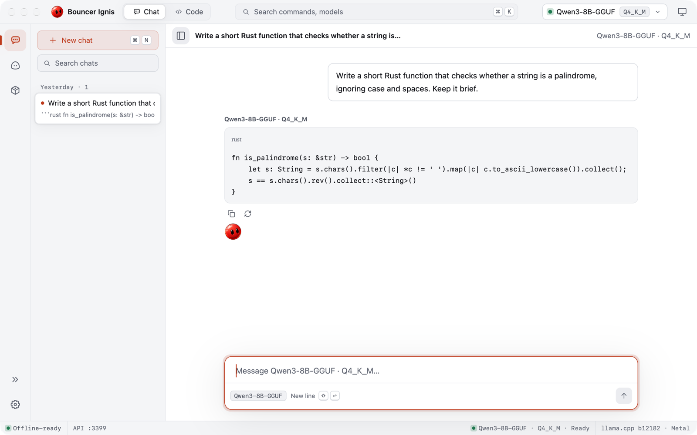

# Getting started

This guide takes you from a fresh install to your first chat with a model running on your own Mac. It takes about ten minutes, plus the time it takes to download a model.

<picture><source media="(prefers-color-scheme: dark)" srcset="images/hero-obsidian.png"><source media="(prefers-color-scheme: light)" srcset="images/hero-light.png"></picture>

## 1. Install Ignis

Run the install command, or download the app yourself. See [Install](install.md). Builds are not signed yet, so macOS may warn you on first launch. [Install](install.md#unsigned-builds) shows how to get past it.

## 2. Open the app

Open Bouncer Ignis from Applications. It starts the `ignis` background service if it is not running. The service runs the models. It keeps running when you close the window, so Rebound routines can run and other apps can use the [local API](local-api.md). **Settings, Engine** shows its state and lets you stop and start it.

The engine is built into Ignis. There is nothing separate to install.

## 3. Pick and download a first model

Start with a small model. A model in the 4 to 8 billion parameter range is a good first pick on most Macs.

1. Open the **Marketplace** from the left bar, or press <kbd>⌘</kbd> <kbd>6</kbd>.
2. On the **Discover** tab, search, for example `qwen` or `llama`, or pick a model from **Recommended for this machine**. Turn on **Fits this machine** to hide models that are too large.
3. Open a model. Its page lists the GGUF files, which are quantized versions of the model.
4. Each file has a fit label:
   - **Runs well**: comfortable room for your other apps.
   - **Tight fit**: it fits, but leaves little memory for other apps.
   - **Too large**: likely too large to run well on this Mac.
5. Choose a file marked **Runs well** and click **Download**. The button shows the file size.
6. Follow the progress on the **Downloads** tab. You can keep using Ignis while it downloads.

When the download finishes, the model is in the **Library** tab. Downloads need an internet connection. Once a model is on your Mac, you can use it offline.

Some models are gated on Hugging Face. To download one, accept its terms on huggingface.co and set `HF_TOKEN` before you start Ignis. See [Models](models.md#gated-models).

## 4. Start your first chat

1. Press <kbd>⌘</kbd> <kbd>1</kbd> to open **Chat**.
2. Click the model pill in the title bar and choose your model. Ignis loads it. The composer says *Pick a model in the title bar to start…* until a model is chosen.
3. Pick a starter prompt, such as **Explain something simply**, or type your own message. Starters only fill the composer. Nothing is sent until you press <kbd>Enter</kbd>.
4. Watch the speed in the status bar, which shows tokens per second while a reply streams. Press <kbd>Esc</kbd> to stop a reply.

Everything in the chat stays on this Mac.

## Where to go next

- [Chat](chat.md): saved chats, renaming and deleting.
- [Code](code.md): work on a folder with a model.
- [Rebound](rebound.md): make your own bots.
- [Terminal commands](cli.md): `ignis` and `bi`.
- [Local API](local-api.md): use your models from other apps.
- [Keyboard shortcuts](keyboard-shortcuts.md)
- [Troubleshooting](troubleshooting.md): if a model does not load or a download fails.

## Related

- [Install](install.md)
- [System requirements](system-requirements.md)
- [Models](models.md)
