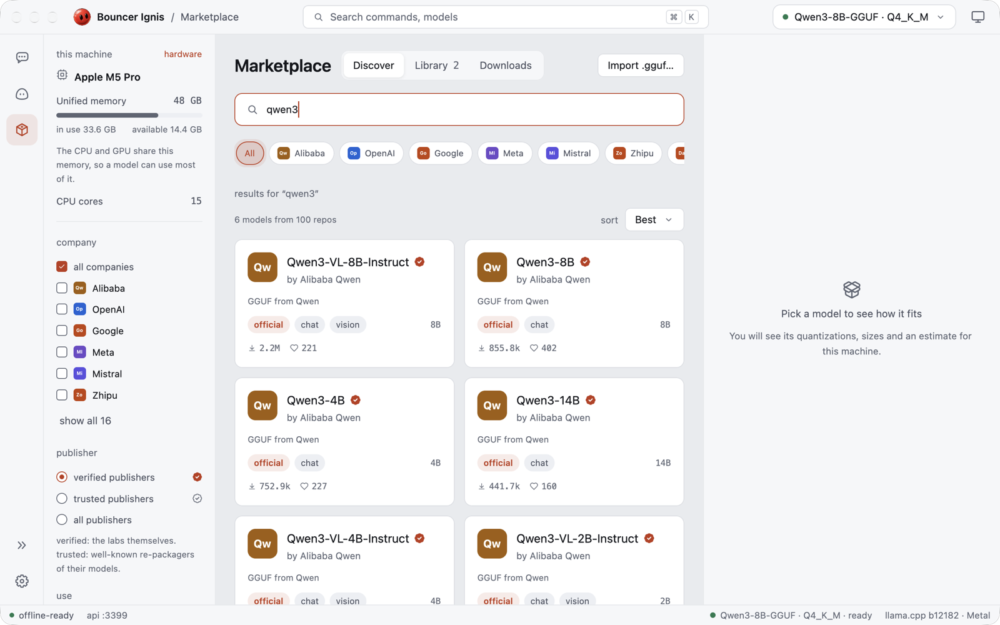

# Models

Ignis runs GGUF models from Hugging Face with llama.cpp. You find them in the Marketplace, keep them in your library, and load them in Chat, Code and Rebound.

<picture><source media="(prefers-color-scheme: dark)" srcset="images/models-obsidian.png"><source media="(prefers-color-scheme: light)" srcset="images/models-light.png"></picture>

## The library

Your models live in Bouncer's model library, in `~/Library/Application Support/Bouncer/models`. Ignis shares it with Bouncer, so a model you download in one shows in the other. Ignis writes to the library only under Bouncer's lock, so the two apps do not clash. See [Ignis with Bouncer](with-bouncer.md).

The **Library** tab in the Marketplace lists your models with their size on disk. For each one you can:

- **Load** it, or **Unload** it to free memory.
- Open **Chat** with it.
- Use **Delete model** to **Remove** it from disk. Unload it first.

An empty library says *Your library is empty*. The same tab has **Import .gguf…** for a `.gguf` file you already have.

In the terminal, `ignis list` shows the library and `ignis rm` removes a model. See [Terminal commands](cli.md).

## The Marketplace

Open it with <kbd>⌘</kbd> <kbd>6</kbd>. It has three tabs: **Discover**, **Library** and **Downloads**.

**Discover** searches Hugging Face for GGUF models. Type in the search box, for example `qwen` or `llama`. With no search, it shows **recommended for this machine** and shelves by maker. Filters:

- **fits this machine** hides files that are too large for your Mac.
- **hide fine-tunes & merges** shows the original models.
- Publishers: **verified publishers** (the labs themselves), **trusted publishers** (well-known re-packagers) or **all publishers**.

Click a model to open it. The page has **Overview**, **Files** and **Model card**. The overview shows the trained context, the base model and an estimate for this Mac.

### Fit

Every file is labeled:

| Label | Meaning |
| --- | --- |
| **Runs well** | Runs comfortably, with room to spare. |
| **Tight fit** | Fits, but leaves little memory for other apps. |
| **Too large** | Likely too large to run well here. |

The estimate counts the weights and the context cache, at the model's default context (at most 16k). On Apple silicon, Ignis keeps the larger of 6 GiB or a quarter of your memory for the system. The page shows a recommended file, and **Other quants** lists the rest.

### Download

Click **Download** on a file. The button shows its size. Follow it on the **Downloads** tab, where you can **Cancel**. A download you cancel keeps its partial files, and running it again resumes.

A repo can also be downloaded from the terminal, with `ignis pull owner/Repo-GGUF`.

### Gated models

Some models are gated on Hugging Face. Accept the model's terms on huggingface.co, then set `HF_TOKEN` in the environment before you start Ignis. Ignis does not store the token. The model page says *This model is gated* when it is.

## Names

Wherever a command or the API takes a model, you can use its full library id (`owner/Repo-GGUF:Q4_K_M`), the repo (`owner/Repo-GGUF`), or just the repo's name (`Repo-GGUF`) when only one quant of it is downloaded. Add `:quant` to pick one. Case does not matter.

## Loading and memory

A model loads when you choose it, and, if **load when needed** is on (it is by default), when a request from the local API names it. **Settings, engine** sets how many models stay loaded at once (1, 2, 3 or auto) and when an idle one unloads (15 minutes, 1 hour, 4 hours or never). When there is no room, Ignis unloads the model used least recently. See [Settings](settings.md#engine).

## Packages

A package is a model with the settings it runs best with, in Bouncer's package format. Ignis shares the format and the package index with Bouncer. In Ignis you work with packages in the terminal:

```sh
ignis search coder                  # search the package index
ignis install owner/name            # install a package and its model
ignis update --check                # list packages that have a newer version
ignis remove owner/name             # remove a package
```

`install` takes `owner/name`, `owner/name@version`, an https URL or a `.bcr.json` file. See [Terminal commands](cli.md#packages) for every option. The package index is Bouncer's, at bouncer-ai.pages.dev.

## Related

- [Getting started](getting-started.md)
- [Settings](settings.md)
- [System requirements](system-requirements.md)
- [Troubleshooting](troubleshooting.md)
