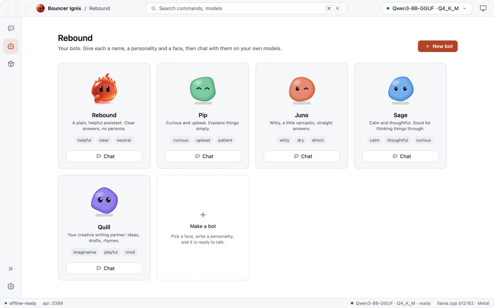

# Rebound

Rebound is where you make your own bots. Each bot has a name, a personality, a face and a greeting. It can remember things about you, and it can run prompts on a schedule. Bots run on your own models, on this Mac. Open Rebound with <kbd>⌘</kbd> <kbd>4</kbd>.

<picture><source media="(prefers-color-scheme: dark)" srcset="images/rebound-obsidian.png"><source media="(prefers-color-scheme: light)" srcset="images/rebound-light.png"></picture>

## Starter bots

Rebound starts with five bots:

| Bot | What it is like |
| --- | --- |
| **Rebound** | A plain, helpful assistant. Clear answers, no persona. |
| **Pip** | Curious and upbeat. Explains things simply. |
| **Juno** | Witty, a little sarcastic, straight answers. |
| **Sage** | Calm and thoughtful. Good for thinking things through. |
| **Quill** | Your creative writing partner: ideas, drafts, rhymes. |

You can edit a starter, reset it to how it shipped, or delete it. A starter you delete stays deleted.

## Make a bot

Click **New bot**, or press <kbd>⌘</kbd> <kbd>K</kbd> and run **New bot**. The builder asks for:

- **Face**: a shape (use **shuffle shape**, **surprise me** or **rebound logo**), a color and eyes. Ignis has eight colors and seven eye styles.
- **Name** (up to 60 characters) and a short line about what it is like (up to 120).
- **Personality**: who the bot is, how it talks, what it cares about and what it should avoid. Up to 8,000 characters. The **start from** chips, such as friendly, witty, calm, creative, coach and tutor, fill in a personality and some traits you can edit.
- **Traits**: short labels. Type one and press <kbd>Enter</kbd>. Up to 8.
- **Greeting (optional)**: the first thing the bot says in a new chat.
- **Creativity**: **precise**, **balanced** or **creative**. This sets how adventurous the replies are.
- **Model**: **Whatever is loaded**, or one model from your library. If a bot has no model of its own, it uses the loaded one.

Click **Create bot**, or **Save** when you edit. The bot's card has a **More** menu with **Edit**, **Duplicate**, **Reset to original** (starter bots only) and **Delete**. Deleting a bot deletes its chats and memories too.

## Chat with a bot

Click a bot to open its room. Each room has **New chat**, **Edit**, **memory** and **routines**. Chats with a bot are saved on this Mac, and the room lists them. The filter **all bots** shows chats from every bot.

## Memory

A bot with memory on remembers short facts about you and puts them in its prompt. It saves new facts itself when you tell it something worth keeping, and you can add your own. Memory is on by default.

Click **memory** in the room to open **What <bot> remembers**:

- Each fact shows whether **it saved** it or **you added** it. **Forget this** removes one.
- **Add something to remember** adds a fact.
- **Forget everything** clears all of them after you confirm.
- The **Remember things about me** switch turns memory on or off. With it off, each chat starts fresh and the button reads **memory off**.

A bot holds up to 200 facts, and each fact is up to 300 characters. Facts stay on this Mac.

## Routines

A routine sends a bot a prompt on a schedule and posts the reply in its own chat, with a notification. Open them with **routines** in the room.

A routine has a name (like "Morning brief") and a prompt (like "Give me a word of the day with an example."), and one of three schedules:

- **daily**: at a time you set, as `HH:MM`, on the days you pick. With no days picked, every day.
- **repeat**: every number of minutes you set.
- **on demand**: only when you click **Run now**.

Click **Save routine** to keep it. The panel shows when each one runs next, when it last ran and why the last run failed, if it did. A bot can have up to 20 routines.

Routines run in the `ignis` background service, so they keep running when the window is closed. The service has to be running, and a model has to be available: the bot's own model, or the one the service keeps warm. A routine's chat keeps its earlier exchanges, so a daily routine can build on yesterday.

See [examples](../examples/rebound-bots.md) for bot ideas.

## Related

- [Chat](chat.md)
- [Models](models.md)
- [Terminal commands](cli.md): `ignis status` and `ignis logs` show the service.
