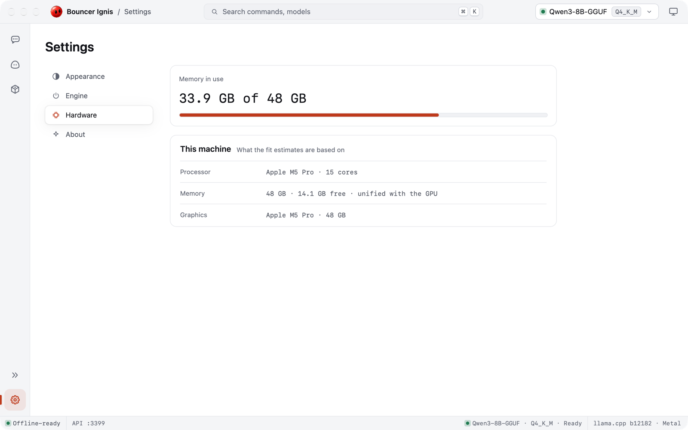

# Settings

Open Settings with <kbd>⌘</kbd> <kbd>,</kbd> or from the left bar. It has four sections: **Appearance**, **Engine**, **Hardware** and **About**. Changes apply at once and are saved in `~/Library/Application Support/Bouncer Ignis/settings.json`.

<picture><source media="(prefers-color-scheme: dark)" srcset="images/settings-obsidian.png"><source media="(prefers-color-scheme: light)" srcset="images/settings-light.png"></picture>

## Appearance

| Setting | What it does |
| --- | --- |
| **Theme** | **System**, **Light**, **Graphite** (soft dark gray) or **Obsidian** (pitch black). System follows macOS. |
| **Accent** | The color for buttons and highlights. Ignis red is the default. Others: signal, slate, mono, ember, glacier, ultraviolet and lime. Every accent passes AA contrast in every theme. |
| **High contrast** | Stronger secondary text and borders. |

You can also change the theme from the command palette (<kbd>⌘</kbd> <kbd>K</kbd>), with **Theme: Light**, **Theme: Graphite**, **Theme: Obsidian** or **Theme: follow the system**.

## Engine

The top of this section is the **Ignis service** card. It shows whether the service is running, with its version, process id and uptime, and has a **Stop service** or **Start service** button. When it is running, the card also shows:

- **Local API**: the address of the [local API](local-api.md), for the OpenAI and Anthropic shapes.
- **Ollama's port**: shown when the Ollama switch below is on.
- **Loaded**: each loaded model and its state.
- **Log**: the path of the service log.

Below the card:

| Setting | What it does |
| --- | --- |
| **Models loaded at once** | 1, 2, 3 or Auto. More than one needs the memory for each. When there is no room, Ignis unloads the model used least recently. The default is 2. |
| **Unload when idle** | 15 min, 1 hour, 4 hours or Never. Frees memory after the last request. The default is 1 hour. |
| **Load when needed** | A request for a model that is not loaded loads it. On by default. |
| **Answer on Ollama's port** | Apps made for Ollama work unchanged: `localhost:11434`, this computer only. Off by default. |

## Hardware

Shows what Ignis sees: your **Processor** and cores, **Memory** in use and free, and **Graphics**. On Apple silicon it notes that memory is unified with the GPU. The fit labels in the Marketplace come from these numbers.

## About

Shows the version, and where Ignis keeps its data (**Ignis data**) and your **Model library**.

## Related

- [Local API](local-api.md)
- [Models](models.md)
- [System requirements](system-requirements.md)
